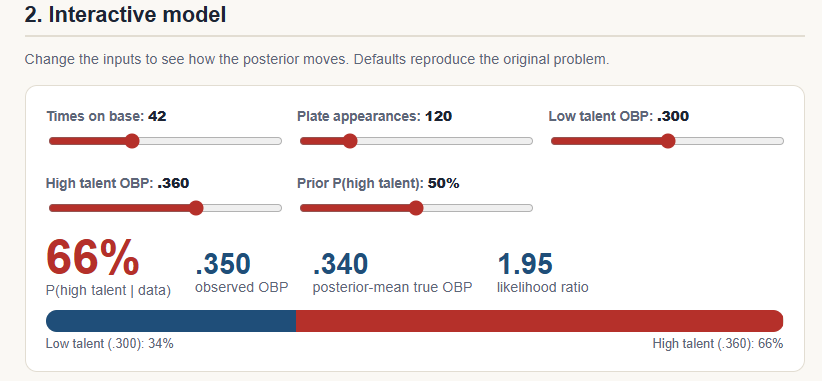
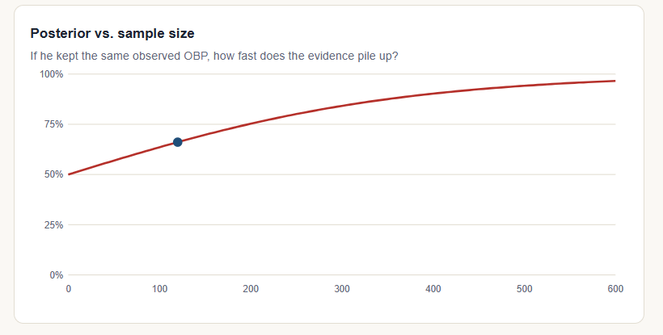

# Bayesian True-Talent OBP: How Much Should 120 Plate Appearances Change What We Believe?

**Part 1 of 2** · Sports analytics · Python · Bayesian inference

**[Live interactive demo](https://ydabus23.github.io/bayesian-obp-true-talent/)**

<!-- Add a screenshot of the calculator here: !
 -->

## The question

Suppose half of the hitters in a league have a true-talent on-base percentage (OBP) of .300 and the other half are true .360 hitters. A hypothetical hitter reaches base 42 times in 120 plate appearances (.350 observed).

**What is the probability he is a true .360 hitter?**

## The answer: about 66%

Not 100%, even though .350 is nearly .360. A hot start is evidence, not proof. The other ~34% is **regression to the mean**, and Bayes' theorem quantifies it.

| Plate appearances (same .350 rate) | P(.360 talent) | Estimated true OBP |
|---|---|---|
| 120 | 66% | .340 |
| 240 | 79% | .348 |
| 360 | 88% | .353 |
| 480 | 93% | .356 |
| 600 | 97% | .358 |

Evidence compounds multiplicatively, so confidence builds slowly. Early-season stats should lean heavily on the league-wide prior.

## Method

With hypotheses `T1 = .300`, `T2 = .360`, and data `k = 42` times on base in `n = 120` PA, the binomial likelihood is `C(n,k) * T^k * (1-T)^(n-k)`. With equal priors, everything cancels except the likelihood ratio:

```
R = (0.360 / 0.300)^42 * (0.640 / 0.700)^78  ≈ 1.95
P(T2 | data) = R / (1 + R) ≈ 0.661
```

For unequal priors, multiply `R` by the prior odds first. The code works in log space to avoid underflow on large samples.

## Run it

```bash
python posterior.py          # prints the results table
pip install pytest
pytest                       # 11 tests, including a cross-check against direct Bayes' rule
```

```python
from posterior import posterior_high
posterior_high(42, 120)                      # 0.661
posterior_high(42, 120, prior_high=0.2)      # skeptical prior -> lower posterior
```

Open `index.html` in a browser for the interactive version (no build step, no dependencies).

## Files

- `index.html`: interactive calculator, posterior-vs-sample-size chart, and write-up
- `posterior.py`: likelihood ratio, posterior, and posterior-mean estimate
- `test_posterior.py`: unit tests

## Limitations

- True talent is continuous, not two-point. This is a teaching model.
- Plate appearances are treated as independent and identically distributed.
- No park, opponent, platoon, or aging adjustments.

## Part 2 (planned)

A **Beta-Binomial** model with a prior fit to real league OBP data: shrunk estimates for actual early-season hitters, a before/after regression chart, and a comparison with the two-point model here.

## Author

Yusuf Dabus
